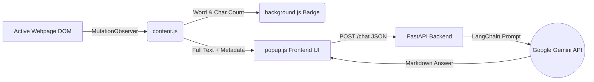

<div align="center">

  <!-- Thumbnail Banner -->
  

  <br />
  <br />

  <h1>✦ PageSense AI — Full-Page Context Chatbot</h1>
  <p>
    <strong>An intelligent Chrome Extension powered by Google Gemini & FastAPI that automatically detects, measures, and ingests 100% of a webpage's text for instant, context-aware Q&A.</strong>
  </p>

  <!-- Badges -->
  <p>
    
    
    
    
    
  </p>

</div>

---

## 🌟 Overview

Most browser chatbots fail on dynamic websites because they either scrape incomplete DOM trees or truncate long articles. **PageSense AI** solves this by using a real-time `MutationObserver` and intelligent DOM extraction engine that automatically calculates the live **word count** and **character count** of any active tab, displaying it directly on the Chrome extension badge and inside the popup UI.

---

## ✨ Key Features (Version 2.0)

- **⚡ Automatic Page Context & Metric Detection:** Real-time tracking of dynamic SPA content, infinite scroll pages, hidden `<details>` accordions, meta descriptions, `mailto:` emails, and `tel:` phone numbers.
- **📰 Editorial Minimalist Interface:** Thoughtfully handcrafted with a warm paper canvas (`#FAF8F5`), near-black typography, and muted forest green accents (`#2B4C38`). No neon glowing borders, purple gradients, or generic AI templates.
- **⏱️ Live Reading Time & Metric Counter:** Automatically calculates live word count, character count, and estimated reading time directly in the popup and toolbar badge.
- **📑 Document Dossier Inspection:** Inspect full URLs, raw extracted context, and contact records in an unobtrusive drawer with one-click copy actions.
- **🧠 250,000-Character Context Window:** Ingests entire technical documentation pages, long-form journalism, and research papers without truncation.
- **🔄 Multi-Model Gemini Fallback:** Built-in resilience that automatically cycles through Google Gemini Flash models (`gemini-2.5-flash`, `gemini-2.0-flash`, `gemini-flash-lite-latest`) to prevent rate-limit interruptions.
- **📋 1-Click Copy & Quick Actions:** Includes editorial action chips (**Summarize**, **Key Facts**, **Takeaways**) and one-click answer copying.

---

## 📸 Screenshots & UI Showcase

| **Full Page Context & Quick Actions** | **Live Word & Character Badge** |
| :---: | :---: |
|  |  |

> 💡 **Tip:** Save the generated promotional image above into your project root folder as **`thumbnail.png`** so the banner and table images render automatically on GitHub!

---

## 🏗️ System Architecture



---

## 📂 Project Structure

```text
PageSense-AI-Complete/
├── thumbnail.png             # Promotional banner image (save your image here)
├── main.py                   # FastAPI server + LangChain + Gemini fallback logic
├── requirements.txt          # Python backend dependencies
├── .env                      # Environment file storing GOOGLE_API_KEY
├── run_backend.bat           # 1-click Windows startup script for the backend
└── extension/                # Chrome Extension (Manifest V3)
    ├── manifest.json         # Extension configuration & permissions
    ├── background.js         # Service worker for live word-count toolbar badge
    ├── content.js            # Auto-detection & deep DOM text extraction
    ├── popup.html            # Modern chatbot interface layout
    ├── popup.css             # Dark-mode styling & micro-animations
    └── popup.js              # Frontend state, fallback injector, and API client
```

---

## 🚀 Getting Started

### 1. Clone or Extract the Project
Download the project folder and navigate into it:
```bash
cd PageSense-AI-Complete
```

### 2. Configure Your Environment
Create or verify the `.env` file in the root directory and add your Google Gemini API key:
```env
GOOGLE_API_KEY=your_google_gemini_api_key_here
```

### 3. Install Dependencies & Start the FastAPI Backend
Install the required Python packages and launch the local server:
```bash
pip install -r requirements.txt
uvicorn main:app --reload --host 127.0.0.1 --port 8000
```
*(On Windows, you can simply double-click `run_backend.bat`)*

Verify the server is running by opening [http://127.0.0.1:8000/health](http://127.0.0.1:8000/health) in your browser.

### 4. Load the Chrome Extension
1. Open Google Chrome and navigate to `chrome://extensions/`
2. Enable **Developer mode** using the toggle in the top-right corner.
3. Click **Load unpacked** in the top-left corner.
4. Select the `extension/` folder inside this project.
5. Pin **PageSense AI** to your toolbar and open any website!

---

## 🔌 API Reference

### `GET /health`
Checks whether the FastAPI backend is online.
- **Response:** `{"status": "ok", "service": "PageSense AI Backend"}`

### `POST /chat`
Processes the full webpage text alongside the user's question.
- **Request Body:**
  ```json
  {
    "question": "What are the main takeaways from this page?",
    "page_url": "https://example.com/article",
    "page_title": "Example Article",
    "page_content": "Full extracted webpage text...",
    "word_count": 5420,
    "char_count": 34120
  }
  ```
- **Response:**
  ```json
  {
    "answer": "**Key Takeaway 1:** ...",
    "words_processed": 5420,
    "chars_processed": 34120
  }
  ```

---

## 📜 License

This project is open-source and available under the **MIT License**.